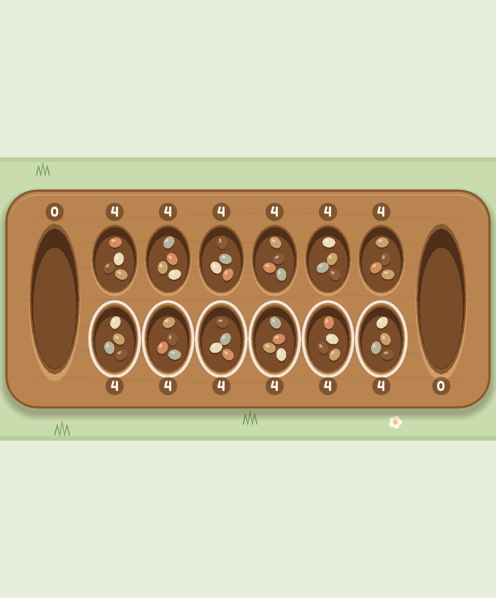
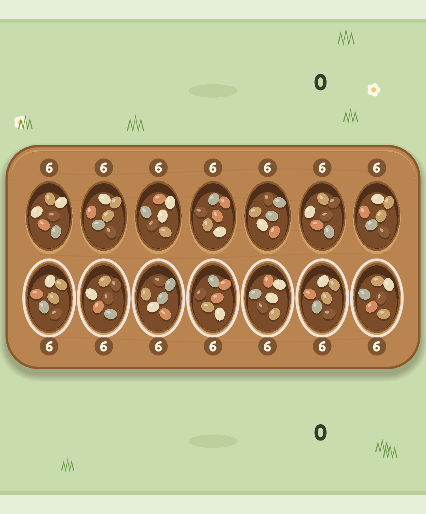
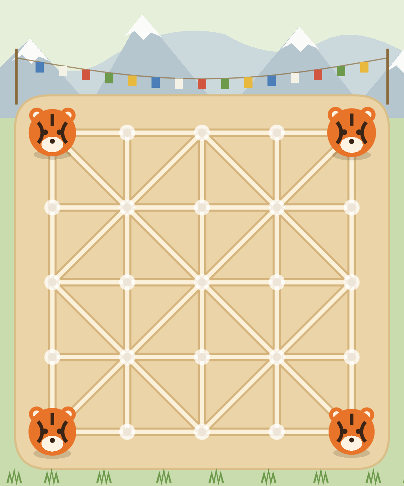
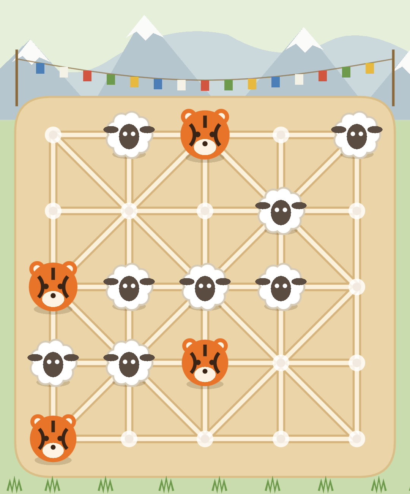

# Traditional Games Project — Discussion Notes

Living document. Updated as the discussion moves. Newest changes are listed in the [Change log](#change-log) at the bottom.

- **Started:** 2026-11-14
- **Direction (confirmed 2026-11-16):** a global multiplayer games platform, built one game at a time. Sections 20 and 21 hold the current plan; where an older section disagrees with them, sections 20 and 21 win.
- **Build plan:** [BUILD_PLAN.md](BUILD_PLAN.md) holds the task-by-task plan for the trial week and release 1, with a progress tracker.
- **Stage:** Planning for release 1 is complete; next is your week 0 preparation, then the trial week. First game, audience, platforms, languages, release phasing and the core Aadupuli rules and the tech stack are decided (see [Decisions](#14-decisions), [section 11](#11-tech-stack-decided-2026-11-15) and [section 17](#17-aadupuli-rules)). Release 1 scope and app structure are decided too (sections 18 and 19). The brand name is not.
- **Workflow:** Ideas and decisions with Fable → development with Opus. Order of work: discuss → decide architecture → detailed plan → build one piece at a time.
- **Caveat on numbers:** every figure here is a rough estimate from general knowledge, not fresh research. Anything marked *(verify)* must be researched before we rely on it.

---

## Current plan at a glance

The short version of everything decided so far. Details and reasons are in the numbered sections.

| Topic | Where things stand |
|---|---|
| Product | A global multiplayer board-games platform: play people or the computer. One app that grows a game at a time. |
| Signature | Rare traditional games alongside familiar world classics that act as doorways. Presented for a global audience, with no regional language or script in the app (section 23). |
| Audience | Players worldwide, English-speaking first. |
| First game | Aadupuli, sold as "Tigers & Goats". Rules in section 17. |
| Second game | Mancala, with Pallanguzhi as the unique variant. |
| Launch | All 17 games (D60): 8 popular, 9 unique. See section 28. |
| Release 1 (about month 4) | Shell plus Aadupuli: versus computer, pass-and-play, tutorial, daily puzzle. No online play, no money features. |
| Later releases | Online play (friends and quick match) is built and in testing (section 26). Then Mancala and Pallanguzhi; then ranks, coins, cosmetics, opt-in ads. |
| Name | **Tiger & Goat** is the first game's name and its store title. The platform brand (and the permanent app identifier) is still open (D44). |
| Languages | English only at launch; text system ready for more languages later. |
| Platforms | Android and web first; iPhone later. |
| Tech | Godot (GDScript) for the game; Godot on a rented machine for the server; plain website with the game embedded. |
| Money | No forced ads, ever. Cosmetics and coins; opt-in ads for extra coins. |
| Chat | Preset phrases and emotes only. |
| Look | "Hill and meadow": the board is a sandy hill with the tigers' cave on the summit and a meadow below; orange tigers and fluffy goats; brass and wood becomes an unlockable theme (section 24). |
| Empty lobbies | Clearly labelled computer opponents after a short wait. No disguised bots. |
| Who builds | Opus writes the code; you review and test. 10–20 hours a week, almost no budget. |
| If late | Cut features, keep the date. |
| Still open | Platform brand name for the app identifier (needed by week 11); phone half of the Godot trial. The board and the tiger start are verified. |
| Build plan | [BUILD_PLAN.md](BUILD_PLAN.md): tasks, checkpoints, risks and the progress tracker. |

---

## 1. The idea

A mobile game (probably web too) that brings back old traditional games, starting with South India and growing outward.

Games named so far:

| Game | Type | Notes |
|---|---|---|
| Paramapadham | Dice race (ancestor of snakes and ladders) | Pure luck. Strong festival tie (Vaikuntha Ekadasi). Each snake/ladder carries a moral meaning. |
| Aadupuli (Aadu Puli Aattam) | Asymmetric strategy, 3 tigers vs 15 goats | Pure skill, no dice. Short matches. |
| Pallanguzhi | Sowing game (mancala family), 14 pits | Deep, but long and harder to teach. Many regional names and rules. |
| Goli (marbles) | Physical dexterity | Not a board game. Needs physics. Parked. |
| Pambaram (spinning top) | Physical dexterity | Not a board game. Needs physics. Parked. |
| Dayakattam / Thayam *(suggested)* | Dice race for 2–4, cousin of Ludo/Pachisi | Borrows existing Ludo demand. Best fit for 4-player multiplayer. |

### Stated preferences

- No forced in-game ads. At most opt-in rewarded ads for extra gold.
- Revenue from cosmetics and game-related purchases.
- Slow and steady growth, not an immediate hit.
- Wants hard truths, not encouragement.

---

## 2. Hard truths

1. **"Forgotten" means no demand.** Nobody searches the store for Pallanguzhi. People who remember it are mostly 40+, who download and pay least. People under 30 don't know the rules. The real product is the teaching, not the board.
2. **Rules can't be owned.** Pallanguzhi and Aadupuli apps already exist, and anyone can copy ours. One developer has had the same three games live since January 2026 with only about a hundred installs each (section 19).
3. **India gives downloads, not revenue.** Roughly 1–2% of players ever pay, in small amounts. Diaspora players (US, UK, Gulf, Singapore, Malaysia) are likely worth many times more each.
4. **Multiplayer is the most expensive feature and the worst one at small scale.** An empty lobby kills a game faster than no lobby.
5. **Goli and pambaram are a different kind of game.** They need a physics engine and a different feel. Parked.
6. **Art and feel are the bottleneck, not code.** Brass, wood, tamarind seeds, cowrie shells and the sound of seeds dropping are the delight.
7. **Most solo games earn close to nothing.** Plan this as a multi-year craft with near-zero running cost, not as income in year one.
8. **"Slow and steady" only works if retention is good.** Stores reward momentum, so fix how many players come back before spending anything on promotion.

---

## 3. Market: what gets downloaded most

Top multiplayer casual games in India: Ludo King, Carrom Pool, 8 Ball Pool, Callbreak.

What they share:

- Players already know the rules.
- Matches are short.
- Private play with friends and family.
- Work offline and on cheap phones, with a small download.

**Lesson for us:** our games fail the first point. Teaching in under a minute has to be excellent.

---

## 4. Retention: what makes people stay

| Honest hooks (use these) | Manipulative tricks the big ones use (avoid) |
|---|---|
| Private rooms with a WhatsApp invite link | Bots disguised as real people |
| 3–8 minute matches | Rigged early wins, then engineered losing streaks |
| Ranks and visible skill growth | Streaks built on loss aversion |
| Festival events and collections | Fake countdown offers and discounts |
| Friends list and rematch button | Betting coins until bankrupt, then selling coins |
| | Two currencies to hide real prices; notification spam |

**Position:** no disguised bots, no rigged dice. For a dice game, trust is the product. "Dice is rigged" is the most common 1-star review in this genre.

Rough retention targets for a casual board game *(verify)*: 35–40% return the next day, 12–15% after a week, 5%+ after a month.

---

## 5. Spending: what makes people pay

- Removing ads and coin packs (for betting) are the biggest earners in this genre.
- Cosmetics only sell when other people see them, so they need a social audience first.
- Season passes work once there are regular players.
- India price points must be small: about ₹10–₹89.
- A one-time "supporter" unlock may beat cosmetics for diaspora parents who want their children to know these games.

---

## 6. Ratings: what loses and earns stars

**Loses stars**

- Forced ads, especially mid-game
- Perceived rigged dice and fake players
- Opponents who stall or quit without penalty
- Coins lost to a dropped connection
- Crashes on cheap phones, or a forced login
- Wrong rules ("that's not how my grandmother played")
- Pay-to-win, toxic chat, notification spam

**Earns stars**

- Smooth reconnection
- Offline play
- House-rule toggles for regional variants
- Replying to reviews
- Asking for a rating only after a win

---

## 7. Moats: staying on top when copied

Leaders are not protected by complexity (Ludo has a thousand clones). They stay on top because:

- Your friends are already there.
- Matches are instant at any hour.
- Rating count and store rank compound.
- Players have years of progress and inventory.
- They have ad budgets.

Making the game complicated only hurts our own players.

**Moats a solo developer can build**

| Moat | How |
|---|---|
| Authenticity depth | Every regional variant, name and story, in regional languages. Big studios won't bother. |
| Home of the category | Each added game makes the whole collection harder to copy. |
| Web presence | Own "how to play Pallanguzhi" searches → play in browser → install. |
| Community | Tamil sangams, schools, festival tournaments. |
| Small niche | Too small for giants to care about, at least at first. |
| Player identity | Rank, friends, collection and history that players don't want to abandon. |

**Risk:** if it gets big, a giant can add our game as a mode within a month. By then the community must be the moat.

---

## 8. Ads

Not necessary. The plan (opt-in rewarded only) is right for ratings and retention. The cost: for most Indian casual games, ads are the majority of revenue.

| Ad type | India, per 1,000 views | US, per 1,000 views |
|---|---|---|
| Rewarded video | about $0.5–2 | about $10–20 |
| Interstitial | about $0.3–1.5 | about $5–12 |
| Banner | about $0.05–0.3 | about $0.5–1 |

*(verify all)*

Example: 1,000 daily Indian players × 2 rewarded ads each ≈ ₹4,000–10,000 a month.

Steps:

1. Open an AdMob account.
2. Add the SDK and a consent prompt.
3. Add rewarded placements.
4. Add mediation once there is volume.

If children are a target audience, only certified ad networks and non-personalised ads are allowed.

---

## 9. Ideas

- **Positioning:** "games your grandmother played", not "forgotten games". A *thinnai* (the veranda where these were played) as the home screen, possibly the name.
- **Mode order:** vs computer and pass-and-play first → friend links → public matchmaking last. Grandparent and grandchild on one phone is the core use case.
- **Honest bots with character:** a named "Paati" opponent, clearly labelled as a computer. Solves the empty lobby without lying.
- **Turn-by-turn play over WhatsApp links:** nobody waits in a lobby.
- **Preset phrases and emotes instead of free chat:** removes most moderation and child-safety problems.
- **Festival events:** Pongal, Vaikuntha Ekadasi (Paramapadham), Onam, Ugadi.
- **Each game ships with its story:** regional names, history, and house-rule toggles.
- **Scheduled play hours** (for example 8–10 pm IST) to concentrate players when public matchmaking arrives.

---

## 10. First game candidates

| Game | For | Against |
|---|---|---|
| **Aadupuli** *(my pick)* | Pure skill, no dice-trust issue. 5–10 minute matches. Strong computer opponent is easy. Looks like nothing else on the store. | Two players only. Unknown to most. |
| **Dayakattam** | Borrows Ludo demand. 2–4 players, good for families. | Dice trust must be earned. Competes with Ludo apps. Needs multiplayer early. |
| **Pallanguzhi** | Deep, beautiful, tactile. | Long matches, complex rules, hard to teach. Better second. |
| **Paramapadham** | Known rules, easy to build, festival hook. | Pure luck. Competes with every snakes-and-ladders app. |

**Status:** decided — Aadupuli is the first release.

---

## 11. Tech stack (decided 2026-11-15)

My first lean was TypeScript in an Android wrapper. You chose **Godot**, so the stack below is built around that choice.

| Part | Choice | Notes |
|---|---|---|
| Game (Android and web) | **Godot 4**, latest stable (4.7.x at time of writing *(verify on the official download page)*) | Language: GDScript. Renderer: Compatibility, for cheap phones and browsers. |
| Rules and computer opponent | Plain GDScript classes with no screen code in them | Must run without the editor so they can be tested from the command line and reused by the server. |
| Online server (release 2+) | **Godot itself, run without a screen, on a rented machine** | One copy of the rules checks every move. About $5 a month. Replaces the earlier Cloudflare idea. |
| Website | **Plain HTML, CSS and JavaScript**, with the Godot web build embedded on a "Play" page | Rules, history and Tamil/English pages that search engines can read. Free static hosting. |
| Who codes | **Opus writes; you review and test** | So: automated tests for every rule, and you do the visual checks in the Godot editor. |
| Source control | Git, with a free private GitHub repository | Not set up yet. |

### What Godot gives us

- Real game feel: smooth animation, particles, sound mixing, and the same look on every device.
- The parked physics games (goli, pambaram) become possible later in the same engine and the same app.
- Free and open source, with no royalties.
- One language for app, computer opponent and server.

### What Godot costs us (accepted trade-offs)

| Cost | Detail | How we limit it |
|---|---|---|
| Bigger download | Roughly 20–35 MB on Android against 5–10 MB for a web-wrapped app *(verify by a test export)* | Ship as an app bundle so each phone gets only its own files; trim the engine later if needed. |
| Heavy web version | The browser must download the engine before the game starts | Test load time on a cheap phone early; the website itself stays light and loads the game only on the Play page. |
| Invisible to search | A Godot game is a canvas | The separate plain website carries all the searchable content. |
| New language for you | GDScript is closer to Python than to PHP or JavaScript | Do the official "Your first 2D game" tutorial (2–3 hours) so you can read and review the code. |
| Opus cannot see the editor | It works through text files and command-line runs | Rules and opponent are tested from the command line; you check how things look and feel. |
| Slower scripting | GDScript runs slower than JavaScript, which matters for the hard opponent's look-ahead | Give the opponent a time limit per move and measure on a cheap phone in the trial below. |
| Server needs looking after | A rented machine must be secured, updated and restarted | Not needed until release 2; keep it to one small machine and one service. |
| Budget | About $5 a month from release 2 | Small, but it ends the "almost nothing" budget once online play starts. |

### Server cost, rough *(verify)*

| Daily players | Machines | Monthly cost |
|---|---|---|
| 1,000 | One small | about $5 |
| 10,000 | One small to medium | about $5–15 |
| 100,000 | One or two medium | about $20–80 |

Turn-based board games send a few tiny messages a minute, so one cheap machine goes a long way.

### First step before real building: a short trial

Before committing months to it, build a throwaway proof in about a week:

1. The 23-point board with pieces that move, one line of Tamil text and one sound.
2. Export it to Android and to the web.
3. Test on the cheapest Android phone you can borrow: download size, start-up time, smoothness, and whether Tamil letters join correctly.
4. Time the opponent's look-ahead on that phone.

If any of these fail badly, we revisit the stack before anything is lost.

### Proposed project layout

| Folder | Contents |
|---|---|
| `game/` | The Godot project: `rules/`, `ai/`, `scenes/`, `ui/`, `i18n/`, `tests/` |
| `site/` | The plain website, with the web build placed under its Play page |
| `tools/` | Command-line scripts: puzzle generator, self-play balance runner |
| `DISCUSSION.md` | This document |

The server is the same `game/` project started in server mode, so it needs no folder of its own.

### Store facts checked 2026-11-15

- **Google Play, new personal accounts:** you must run a closed test with at least 12 testers opted in for 14 days in a row before you can release publicly. Plan for this adding two to three weeks to the first launch, and start lining up 12 friends and family early. ([Google's help page](https://support.google.com/googleplay/android-developer/answer/14151465?hl=en))
- **Selling digital items on Google Play** must go through Google's own billing.

---

## 12. Legal and store notes (all to verify)

- **Online Gaming Act 2025:** bans games played for money winnings. Free social games with cosmetics are the encouraged category. Keep all currency non-cashable.
- **DPDP Act:** parental consent rules for under-18s and limits on tracking children. Collect as little data as possible; no login required to play.
- **Store fees:** Google and Apple both take 15% from small developers (under $1M a year). Google account is a one-time $25; Apple is $99 a year.
- **Google Play:** new personal developer accounts must run a closed test with testers before public release.

---

## 13. Topics still to discuss

| # | Topic | Status |
|---|---|---|
| 1 | Smallest version that delights, and a sustainable weekly schedule | Decided (section 18) |
| 2 | Regional rule variants for each game, with sources | Aadupuli done (section 17); other games not started |
| 3 | Single-codebase stack and server costs | Decided (section 11, D15–D18); trial build still to do |
| 4 | Fair, server-controlled dice and showing players they're fair | Not started |
| 5 | Computer opponents: easy, medium, hard (and whether Aadupuli is solved) | Solved question answered (not solved; section 17); level design not started |
| 6 | In-game economy: currencies, earning, spending, price points | Not started |
| 7 | Empty-lobby problem without fake players | Decided (D5) |
| 8 | Design for ages 8 to 70 on cheap Android phones | Not started |
| 9 | Cost to acquire a player, lifetime value, break-even (India vs diaspora) | Not started |
| 10 | Store keyword research in six languages plus transliterations | Not started |
| 11 | GST, store fee tiers, company vs sole proprietorship | Not started |
| 12 | Compliance checklist: Online Gaming Act, DPDP, Play Families policy | Not started |
| 13 | Chat moderation and safety for minors | Decided: preset phrases and emotes only (D29) |
| 14 | Soft launch: region, success numbers, six-month festival calendar | Not started |
| 15 | Analytics events and first A/B tests | Not started |

---

## 14. Decisions

| # | Decision | Date |
|---|---|---|
| D1 | First game is **Aadupuli**. | 2026-11-14 |
| D2 | ~~Player number one is young adults, 18–30, in India.~~ **Replaced by D26.** | 2026-11-14 |
| D3 | Main goal for the first two years is **preserving the games**; money is a bonus. | 2026-11-14 |
| D4 | **Phased releases.** Release 1: versus computer, pass-and-play, shareable daily puzzle. Release 2: friend link online. Release 3: public matchmaking. | 2026-11-14 |
| D5 | Empty lobby is handled with a **clearly labelled computer opponent after a short wait**. No disguised bots. | 2026-11-14 |
| D6 | **Android and web first.** iPhone once revenue covers Apple's yearly fee. | 2026-11-14 |
| D7 | ~~Launch languages are English and Tamil.~~ **Replaced by D40.** | 2026-11-14 |
| D8 | Art is **AI-generated, then polished by hand**. | 2026-11-14 |
| D9 | Budget before revenue is **almost nothing** (under ₹5,000): store fee and a domain. | 2026-11-14 |
| D10–D14 | Aadupuli rules: see [section 17](#17-aadupuli-rules). | 2026-11-15 |
| D15 | The game is built in **Godot** (GDScript), for Android and web. | 2026-11-15 |
| D16 | **Opus writes the code; you review and test.** | 2026-11-15 |
| D17 | The online server (release 2+) is **Godot run on a rented machine**, checking every move with the same rules as the app. | 2026-11-15 |
| D18 | The web side is a **plain website with the Godot game embedded** on a Play page. You are most at home in plain JavaScript, so the site uses no framework. | 2026-11-15 |
| D19–D22 | Release 1 scope: see [section 18](#18-release-1-scope-and-schedule). | 2026-11-15 |
| D23–D24 | One app holding many games; game-led store title: see [section 19](#19-name-app-structure-and-competition). Brand name still open, needed by week 11. D24 is refined by D32. | 2026-11-15 |
| D25 | **Direction: a global multiplayer games platform, built one excellent game at a time.** Unique games are the signature; familiar games are the doorways. | 2026-11-16 |
| D26 | **Audience: players worldwide**, casual and strategy, English-speaking first. Replaces D2. | 2026-11-16 |
| D27 | **Release 1 is one deep game** (Aadupuli) inside the platform shell, with the home shelf showing what comes next. | 2026-11-16 |
| D28 | **The second game is Mancala with Pallanguzhi** as its unique variant. | 2026-11-16 |
| D29 | **Chat is preset phrases and emotes only.** No free typing. | 2026-11-16 |
| D30 | ~~English and Tamil at launch.~~ **Replaced by D40.** | 2026-11-16 |
| D31 | **Ads are never forced.** Opt-in ads for extra coins arrive with the coin economy and online play; release 1 still has no money features (D19 stands). | 2026-11-16 |
| D32 | **Store titles lead with the world family name** people search for, for example "Tigers & Goats", with the traditional name alongside. Refines D24. | 2026-11-16 |
| D33 | **Turn-based games only for now.** Live physics games (carrom, pool, goli, pambaram) stay parked. | 2026-11-16 |
| D34 | **Aadupuli starts on the classic 23-point board**, verified against your picture. More boards and piece-count options may be added later if needed. | 2026-11-16 |
| D35 | **Fixed start confirmed:** tigers begin on the top point and the two centre points of the first row. | 2026-11-16 |
| D36–D39 | Visual design: brass-and-wood board, pieces by shape and colour, light calm app, kolam patterns and unlockable themes. See [section 22](#22-visual-design-direction). D39 is narrowed by D40. | 2026-11-16 |
| D65–D67 | Bagh-Chal: own game card, traditional no-repeat rule, Himalayan touch on the hill and meadow look. See [section 30](#30-game-3-bagh-chal-rules). | 2026-11-27 |
| D61–D64 | Mancala: 4 seeds; Pallanguzhi: turn ends after capture, pasu goes to the pit's owner (D63, changed after self-play), one round. See [section 29](#29-game-2-mancala-kalah-and-pallanguzhi-rules). | 2026-11-27 |
| D10, D58–D60 | 5 captures kept; summit spacing; goats win after 40 tiger moves without a capture; launch with all 17 games. See [section 28](#28-balance-the-40-move-rule-and-launching-with-17-games). | 2026-11-26 |
| D55–D57 | Next games: Mancala with Pallanguzhi next; all four game families in year one; launch Tiger & Goat first. See [section 27](#27-the-next-games). | 2026-11-26 |
| D50–D54 | Online play: filtered names, 45-second turns, server on this computer for now, computer offer after 20 s, online before Mancala. See [section 26](#26-online-play). | 2026-11-26 |
| D46–D49 | App structure: four tabs, optional name and avatar, "Soon" items, phase 1 starts now. See [section 25](#25-app-structure-plato-style). | 2026-11-26 |
| D45 | Default look is "Hill and meadow"; brass and wood becomes the Heirloom theme. See [section 24](#24-hill-and-meadow-look). | 2026-11-25 |
| D40–D44 | Global focus: English only, Tiger & Goat as the first game's name, Fredoka and Figtree fonts, Plato-like play screen. See [section 23](#23-global-focus-and-the-name-tiger--goat). | 2026-11-25 |

---

## 15. Your answers

| Question | Answer |
|---|---|
| Strongest background | Web: PHP and JavaScript |
| Art and sound | AI-generated, then polished |
| Hours per week | 10–20 |
| Main goal | Preserve the games |
| Player number one | Young adults 18–30 in India |
| First game | Aadupuli |
| Modes wanted | Versus computer, pass-and-play, friend link, public matchmaking (all four, released in phases) |
| Budget | Almost nothing |
| Release phasing | Phased |
| Empty lobby | Labelled bot after a wait |
| Platforms | Android and web first |
| Languages | English and Tamil |

---

## 16. What the answers mean

### Rough timeline at 10–20 hours a week

| Release | Contents | Rough timing |
|---|---|---|
| 1 | Versus computer (easy, medium, hard), pass-and-play, interactive tutorial, daily puzzle, English and Tamil | Month 3–4 |
| 2 | Friend link online (WhatsApp invite), rematch, basic profile | Month 5–6 |
| 3 | Public matchmaking with labelled bot fallback, ranks | Month 8–10 |
| Later | Second game (Pallanguzhi or Dayakattam), cosmetics, iPhone | After release 3 |

### Tensions to watch

1. **Goal versus audience.** Preserving the games through young adults is the right pairing (they are the ones who need to learn them), but they don't know the rules and have no nostalgia. The hook must be "a sharp two-player strategy game", with heritage as flavour, not a history lesson.
2. **Young adults expect online play.** Release 1 has none. The daily puzzle and sharing have to carry interest until release 2.
3. **AI art consistency.** AI images drift in style between pictures. Suggestion: draw the board and pieces in code as clean vector shapes (kolam-like geometry), and use AI only for backgrounds, story illustrations and the store listing. Check the tool's licence allows commercial use.
4. **Near-zero budget means near-zero promotion.** Growth has to come from sharing, search and community. That makes the web version and the daily puzzle core features, not extras.
5. **PHP hosting does not suit live matches.** XAMPP-style hosting works for a website but not for real-time play. Release 1 needs no server at all. *(Settled 2026-11-15: the live server will be Godot on a rented machine, D17.)*

### New ideas from this round

- **Daily puzzle.** One position a day ("tiger to capture in two", "goats to trap in three") with a shareable result, like a daily word game. Needs no opponent and no server. Puzzles can be generated and checked automatically, because a short forced win is easy for a computer to prove.
- **Play both sides.** A match is two games, once as tigers and once as goats, so the asymmetry feels fair and ranks make sense.
- **Hard level as a deep-search player.** Strong but not provably perfect (see the correction in section 17); "easy" and "medium" make deliberate, human-looking mistakes.
- **Named computer opponents.** For young adults, give each level a character with a face and a line or two in Tamil and English.
- **Post-match replay with one hint.** "This was the move that lost it." Teaches the game and gives a reason to play again.
- **Other names for store search.** Aadu Puli Aattam, Puli Meka (Telugu), Adu Huli (Kannada), and the Nepali cousin Bagh-Chal. *(verify spellings and reach)*

---

## 17. Aadupuli rules

Researched 2026-11-14/15. Several rule pages could not be opened by automated reading, so the base is two documents read in full plus search summaries (marked).

### Sources

| Source | What it gave us | Reliability |
|---|---|---|
| [Funskool "Goats and Tigers" instruction sheet, 2022](https://funskoolindia.com/wp-content/uploads/2024/09/9548100-Goats-Tigers-2022-Instructions.pdf) | A complete commercial ruleset from an Indian publisher | Read in full |
| [Agarwal & Iida, "Analyzing thousand years old game: Tigers and Goats is still alive", APJITM 2018](https://doi.org/10.17576/apjitm-2018-0702-01) | Rules summary, repetition rule, comparison with Bagh-Chal | Read in full; small study, treat its numbers as weak evidence |
| [Wikipedia, "Lambs and tigers"](https://en.wikipedia.org/wiki/Lambs_and_tigers) | Regional names, history notes. Contains no rules of play. | Read in full |
| Other pages (Indian Culture Portal, Durham University, Singapore Indian Heritage Centre, blogs) | "Tigers win at 5 captures" | Search summaries only; pages would not open. *(verify)* |

### Where sources agree

- 23-point board, 3 tigers, 15 goats, two players.
- All three tigers are on the board from the start; one sits on the top point (apex).
- The goat player goes first, placing one goat per turn on any empty point.
- Tigers move from their first turn, one step along a line to an empty neighbouring point.
- A tiger captures by jumping over one neighbouring goat to the empty point directly behind it. Captures are allowed from the start.
- One goat per jump, one jump per turn. A tiger cannot jump a tiger or two goats in a row.
- Goats never jump and cannot move until all 15 have been placed.
- Goats win by trapping all three tigers so none can move.

### Where sources differ or are silent

| Point | Funskool | 2018 paper | Other sources |
|---|---|---|---|
| Tiger win | Capture all 15 goats | "A given number" of goats | Mostly 5 *(verify)* |
| Other two tigers | Any two of the four points nearest the top | Two fixed centre points (from its board picture) | — |
| Endless repetition | Silent | Same back-and-forth move at most three times in a row | One mentions a draw |
| Must a tiger capture when it can? | Silent (so: optional) | Silent | — |
| Match format | Silent | Each player plays once as goats and once as tigers | — |

### Board layout (verified 2026-11-16)

1 top point, then three rows of 6 points, then a bottom row of 4, joined by four lines fanning down from the top, by the horizontal rows, and by the rectangle's left and right sides. That is 23 points and 38 connections. **Confirmed against the board picture you supplied**, saved at [docs/board-reference.png](docs/board-reference.png). The numbered version is in BUILD_PLAN.md section 4.

**D34 (2026-11-16):** we start with this board. More boards ("maps") and other piece counts may be added later as options if needed, so the board is data and the counts are settings.

### Decisions from this round

| # | Decision | Date |
|---|---|---|
| D10 | Tigers win at **5 captured goats** as the working default. Before launch, the computer plays itself at 4, 5, 6 and 7 and we keep the most even setting. | 2026-11-15 |
| D11 | The tiger start is a **selectable game mode**, not one fixed rule (see below). | 2026-11-15 |
| D12 | **Repeating is not allowed.** A player cannot make a move that recreates an earlier position too many times; they must find a different move. No draws by repetition. | 2026-11-15 |
| D13 | Published rules are the base. You played as a child and remember it hazily, so you check each rule against memory. | 2026-11-15 |

### Start modes (D11)

Your answer was: "add game mode type fixed, coin decide, turn based, etc". My reading of it (the coin toss is confirmed; the other modes follow from your wording):

| Mode | What happens | Where used |
|---|---|---|
| **Fixed** | Tigers start on the top point and the two centre points below it. | Default. The only mode in ranked play and daily puzzles. |
| **Tiger's choice** | One tiger on top; the tiger player picks two of the four nearest points (Funskool rule). | Friendly and versus computer |
| **Placed in turns** | Tigers enter one at a time, alternating with the first goats. | Friendly and versus computer |
| **Coin toss** | A coin decides who plays tigers and who plays goats. | Any single game that is not a two-game match |

**Confirmed 2026-11-15 (D14):** "coin decide" is a toss for sides: the coin decides who plays tigers and who plays goats. It does not change the start position.

**Caution:** every mode needs its own tutorial line, computer-opponent testing and balance check. I'd ship release 1 with Fixed plus coin toss only, and add the other two in a later update.

### Details I propose (not yet confirmed)

- **Repetition, exactly:** a move that would create the same full board position for the third time is greyed out, with a one-line explanation. If that leaves a player with no legal move, they lose.
- **Trapped during placement:** if all three tigers are trapped before the 15th goat is placed, goats win immediately.
- **Goats with no legal move** (very rare): tigers win.
- **Capturing is optional.**
- **Match format:** one match is two games with sides swapped, so the lopsided roles are fair. Tie-break if each player wins one: more goats captured as tigers, then fewer total moves.
- **Turn timer:** 30 seconds per move in online play, none against the computer or in pass-and-play.
- **House rules for friendly games:** capture target (5, 7 or all), start mode, multiple jumps in one turn.

### Is the game solved? Correction to earlier notes

- The often-quoted "solved, it's a draw" result (Jin & Nievergelt, 2009) is for **Bagh-Chal**, the Nepali game on a 5×5 board with 4 tigers and 20 goats. The 2018 paper says so in its own text.
- I found **no published solution for the 23-point South Indian board**.
- My earlier note that it is "small enough to solve completely on a laptop" was too confident. My own rough count is on the order of ten billion positions: possible as a one-off overnight job on a PC, but far too large to ship inside the app.
- **What this changes:** the hard computer opponent will be a deep search, strong but not provably perfect. Daily puzzles are still safe, because a puzzle only needs a short forced win that the search can prove.

### A warning from the research

The 2018 paper measured Aadupuli as having far fewer choices per turn than Bagh-Chal (about 3 versus about 9) and longer games (about 50 moves versus 39), and argues this is why it faded while Bagh-Chal stayed popular. The study is small, so treat it as a caution, not a fact. If our own playtests feel slow, the levers are the capture target, the turn timer, quick animations and the puzzle mode.

### Suggested homework

- Draw the board on paper and play 20–30 games with coins and seeds before we build anything. Note where it drags and where it's exciting.
- Ask two or three elders how they played: tiger start, how tigers win, any special rules. Even a voice note each is valuable.

---

## 18. Release 1 scope and schedule

Decided 2026-11-15. Target: public release about four months after the trial week, at 10–20 hours a week.

### Decisions from this round

| # | Decision | Date |
|---|---|---|
| D19 | **No money features in release 1**: no ads, no shop, no purchases. | 2026-11-15 |
| D20 | **Come-back hooks wanted:** daily puzzle streak with sharing, ladder of named opponents, board themes unlocked by playing, replay with one hint after a loss. | 2026-11-15 |
| D21 | Progress is saved on the phone, with **optional Google sign-in backup**. | 2026-11-15 |
| D22 | **If late, cut features and keep the date.** Unfinished items move to a 1.1 update. | 2026-11-15 |

### Honest note on D20 and D21

You chose all four hooks plus sign-in backup. Together they add roughly four to six weeks to an offline game, so not all of them will fit by month 4. Because D22 says the date wins, the cut order below decides in advance what slips. I expect the last one or two items to land in 1.1.

### Core: release 1 does not ship without these

| Area | Contents |
|---|---|
| Play | Rules as in section 17. Fixed start. Coin toss or choose your side. Legal-move highlights, capture animation, sound, vibration. |
| Tutorial | Interactive, under 90 seconds, skippable: place a goat, move a tiger, jump, move goats after the 15th, trap to win. |
| Versus computer | Three named opponents (easy, medium, hard), playable as tigers or goats. Undo allowed. |
| Pass-and-play | Two people, one phone. No undo. |
| Daily puzzle | One puzzle a day, the same for everyone, working offline from a bundled set. Streak counter. Share the result to WhatsApp with a link. |
| Languages | English and Tamil, switchable in settings. All text in translation files. |
| Basics | Settings (sound, vibration, language), "How to play" and a short story of the game, simple stats, progress saved on the phone, privacy policy. |
| Website | Home, rules in English and Tamil, privacy policy, and the Play page if the web build passes the trial. |

### Stretch: built in this order, cut from the bottom

| Order | Item | Rough cost | Note |
|---|---|---|---|
| 1 | Opponent ladder | 2–3 days | Each opponent is "cleared" by beating them as tigers and as goats. Cheap because the opponents already exist. |
| 2 | One unlockable board theme | About a week | Start with one extra look, earned by a puzzle streak or by clearing the ladder. More themes follow in updates. |
| 3 | Google sign-in backup | About a week | Suggestion: use Google Play Games saved games, so backup lives in the player's own Google account and we run no server. Android only; the web version stays on-device. *(verify the Godot plugin in the trial)* |
| 4 | Replay with one hint | 1–2 weeks | Shows the move that lost the game. Most valuable for learning, but the costliest, so it is the first to slip to 1.1. |

### Out of release 1

Online play, accounts of our own, ranks, chat and emotes, shop and cosmetics for sale, ads, the other start modes, house-rule toggles, iPhone, more languages, a second game, and any analytics kit (proposal: rely on Google Play Console's own install and active-user figures for now).

### Timeline

| Weeks | Work | Checkpoint |
|---|---|---|
| 0 | **You:** install Godot and do the first-game tutorial; play 20–30 games on paper; verify the board; open the Google Play developer account ($25); start asking 12 testers. | — |
| 1 | Trial build (section 11): board, Tamil text, sound, exports, cheap-phone test. | **Go or no-go on Godot** |
| 2–3 | Rules with automated tests; board screen; pass-and-play. | **A:** two people can play a full, correct game on one phone |
| 4–6 | Three computer opponents; computer self-play to settle the capture target (D10). | **B:** all three levels playable, target chosen |
| 7–8 | Tutorial, first-run flow, Tamil throughout. | **C:** five first-timers finish a game with no help from you |
| 9–10 | Puzzle generator, puzzle screen, streak, sharing. | **D:** 120 checked puzzles bundled |
| 11–12 | Art, sound and animation polish; stats; settings; website; stretch items in order. | Feature freeze |
| 13–14 | Closed test with 12 testers for 14 days; bug fixes; store listing in English and Tamil. | Google's testing rule met |
| 15–16 | Buffer and public release. | **Release 1** |

At every checkpoint we check the date against the plan and cut from the bottom of the stretch list if behind.

### A sustainable week

- **Three weeknight sessions of about 2 hours** and **one weekend block of 4–6 hours**: 10–12 hours in a normal week, up to 16–18 in a good one.
- **One full day off** every week, with no project work.
- **One goal per week**, ending with a build you can open on your own phone.
- **Every fourth week is lighter:** play the game, tidy, review notes, no new features.
- **Working with Opus:** one task per session, starting from this document and the build plan. You test on the phone at the end and note problems for the next session.

### What "good" looks like before starting release 2

| Measure | Target |
|---|---|
| First-timers who finish the tutorial | 70% or more |
| Players who return the next day | 30% or more |
| Players who return after a week | 10% or more |
| Store rating | 4.3 or higher |
| Sessions without a crash | 99% or more |

*(Targets are my estimates.)* With no promotion, expect tens to low hundreds of installs in the first month, so these numbers will be noisy. What the 12 testers and early reviewers say matters more at this stage. Release 1's job is learning, not growth.

### Things to settle before the closed test

- **Brand name.** Structure is settled (one app, D23). The brand name is still open and is needed by week 11, because the app's permanent identifier carries it (section 19).
- **Privacy policy text.**
- **Store listing:** title, short description, screenshots, in English and Tamil.

---

## 19. Name, app structure and competition

Discussed 2026-11-15.

### Decisions from this round

| # | Decision | Date |
|---|---|---|
| D23 | **One app that grows to hold many games.** The home screen is a shelf that starts with Aadupuli. The permanent app identifier is based on the brand, not on one game. | 2026-11-15 |
| D24 | **Store title leads with the game, brand appears as the developer name**, for example "Aadu Puli: Tigers & Goats" by "<Brand> Games". The title can be changed later as games are added. | 2026-11-15 |
| — | **Brand name: to be decided later.** | Open |

### Brand name deadline

The app identifier is fixed for ever at the first upload to Google Play, and it should carry the brand. So the name must be chosen **by week 11** of the timeline, before the closed test in week 13. Until then the project uses a placeholder name.

### Shortlist so far

| Name | Meaning | For | Against |
|---|---|---|---|
| Thinnai *(my pick)* | The veranda where these games were played | Warm, easy to say, home screen can be a thinnai | Used by a Tamil literary magazine and restaurants (not in games); `thinnai.in` appears taken |
| Mutram | Open courtyard of a traditional house | Suggests a gathering place for many games | Less familiar word |
| Sozhi | Cowrie shells used as dice | Short, distinctive, ready-made logo | "zh" is hard for non-Tamil speakers |
| Aadukalam | Playing arena; pun on aadu (goat) | Competitive tone for young adults | Search dominated by the 2011 film |

Checks done 2026-11-15: web searches found no game or app using any of the four names. A quick lookup found no records for `thinnai.games`, `thinnaigames.com`, `playthinnai.com`, `mutram.games`, `mutramgames.com`, `sozhi.games`, `sozhigames.com` or `aadukalam.games`. That is a hint they are free, not proof; confirm at a registrar. Note that `.games` addresses usually cost more per year than `.com` or `.in`.

Still to check for the final choice: an exact search inside the Play Store, and the Indian trademark register.

### Competition found

Figures come from third-party trackers, not from Google, so treat them as rough.

| App | Developer | What it is | Installs (tracker) |
|---|---|---|---|
| [Aadu Puli – Tamil Board Game](https://appgoblin.info/apps/com.chozhanaadu.adupuliattam) | Chozhanaadu Apps | Offline, computer opponent at three levels, tigers win at 5. Released January 2026. | about 150 |
| [Thayam – Tamil Traditional Game](https://appgoblin.info/apps/com.chozhanaadu.thayam) | Chozhanaadu Apps | Dice game on a 7×7 board, ad-supported. Released January 2026. | about 130 |
| [Pallankuzhi](https://appgoblin.info/apps/in.chozhanaaduapp.pallankuzhi) | Chozhanaadu Apps | Friends or computer, offline, English and Tamil. | about 90 |
| [Aatalu: Indian Board Games](https://apkcombo.com/aatalu-indian-board-games/io.puya.games/) | puya.games | Seven games in one app, including Aadupuli. | near zero |
| Goats or Tigers; Puli Meka & More | Others | iPhone apps. | Not known |

### What the competition tells us

- **This is the hard truth about demand, measured.** A developer has had almost our exact plan (the same three games, offline, computer opponent, Tamil) live for about ten months and trackers show roughly a hundred installs per app. Putting a good version in the store is not enough; nobody is searching.
- **Splitting games into separate apps has not helped them.** Each app starts from zero. This supports D23.
- **Their feature list is our starting line, not our edge.** Offline play and three opponent levels are expected. Our differences have to be the tutorial, the daily puzzle with sharing, the feel, and the website that brings people in from search.
- **Homework:** install the Chozhanaadu Aadupuli app and play it for an hour. Note what is confusing, what is missing and what they do well.
- **Growth must be planned, not hoped for.** The sharing loop and the website matter as much as the game. This raises the priority of the launch and growth topic (14) and keyword research (10).

### A privacy point to settle with the legal topic

On a personal Google Play developer account, Google shows the developer's legal name publicly, and for accounts that earn money it also shows a full address *(verify current rule)*. An organisation account avoids putting a home address on show but needs a registered business and a D-U-N-S number. This belongs with topic 11 (company or sole proprietorship).

---

## 20. New direction: a global multiplayer games platform

Raised by you on 2026-11-16, after trying existing Tamil game apps (pagadai, aadu puli, goli and others).

### What you saw and proposed

- Existing Tamil game apps feel machine-made and blunt, have no pool of players, and many share the same Tamil names.
- **New direction:** aim at the **global market**, with one **multiplayer games platform** (against people and against the computer).
- **Games:** Tamil games, plus some of the most-played games, plus a few unique board games.
- **Ads:** never forced; available by choice for extra coins and similar rewards.
- **References:** Plato first (easy game selection, clear rule explanations, playability, no lag), then Ludo King and Carrom Pool.
- **Reasoning:** familiar games bring more players in.

### My assessment

**Where you are right**

- The gap you found is real: quality and a player pool, not the idea, are what is missing.
- Familiar games solve the "nobody searches for Aadupuli" problem. People arrive for what they know and discover the rest.
- A global audience is worth far more per player than an India-only one, and D23 (one app, many games) already points this way.
- Godot suits this vision better than my web-wrapper suggestion did.

**Hard truths**

1. **Plato is the product of a company, not a person.** It lists about 50 games, with chat rooms and voice chat, and says "10 million+" people *(its own store listing; unverified)*. Ludo King and Carrom Pool belong to large studios. Matching them game for game, solo and part-time with no budget, is not realistic.
2. **A platform makes the empty-lobby problem worse, not better.** Players are split across every game and every time zone. Five hundred people online across ten games worldwide means every lobby is empty.
3. **Nobody leaves Ludo King for a weaker Ludo.** A familiar game only pulls people in if ours is at least as good, or if the platform gives another reason to stay (friends, one identity, unique games).
4. **Physics games played live (carrom, pool, goli) are a different class of difficulty** from turn-based board games. They should wait a long time.
5. **"Looks AI-made" is our risk too.** The plan is AI-assisted art and AI-written code. Avoiding that look needs one consistent, deliberate style and a lot of care over feel.
6. **Global means more rules:** consent screens for European players, children's privacy law in the US, and age ratings, especially once ads are in.

### What I recommend: keep the vision, change the route

**The platform is the destination. One excellent game at a time is the road.**

- **The signature is the unique games; the familiar games are doorways.** Each Tamil game belongs to a family the world already searches for:

| Our game | World family people search for | Evidence of demand |
|---|---|---|
| Pallanguzhi | Mancala | One mancala app shows about 766,000 installs on a tracker *(rough)* |
| Dayakattam / Thayam | Ludo, Pachisi, Parcheesi | Ludo is the biggest board-game category in India |
| Paramapadham | Snakes and ladders | Universally known |
| Aadupuli | Tigers and goats, fox and geese, Bagh-Chal | Known among strategy-game fans; small |

  So the store can say "Mancala" and the game can offer Pallanguzhi as the variant nobody else has.

- **Build order by cost and reach, turn-based only:** Aadupuli → Pallanguzhi/Mancala → Dayakattam/Ludo → cheap world classics (Nine Men's Morris, Checkers, Reversi, Four in a Row, Dots and Boxes).
- **Use generic names** for classics. Several familiar names are trademarks (for example Othello, Connect Four, Battleship).
- **Take principles from Plato, not its look:** game picking in one tap, rules explained on one screen, instant start, no waiting. Our visual identity must be our own.
- **Design for an empty pool from day one:** every game is fully enjoyable against the computer; clearly labelled computer opponents fill empty lobbies (D5); friend links; turn-by-turn matches.
- **Realistic pace:** after the app shell exists, roughly one polished game every two to three months. In two years that is six to eight games with online play, which is a real platform.

### What this changes in earlier decisions (confirmed 2026-11-16, see D25–D33)

| Earlier decision | Change |
|---|---|
| D2: player number one is young adults in India | **Worldwide casual and strategy players**, 16–35, English-speaking first |
| D7: English and Tamil | **English first.** Tamil kept as a language option and as flavour (names, stories). More languages later. |
| D19: no money features in release 1 | Still none in release 1. **Opt-in ads for coins** arrive with the coin economy, alongside online play. |
| D4: online play in release 2 | Unchanged in order, but online play becomes the core of the product, so the shell is designed for many games and for accounts from the start. |
| D24: store title leads with the game | Title leads with the **world family name** people search for, for example "Tigers & Goats". |
| Brand shortlist (section 19) | Needs a name that works worldwide: short, easy to say and spell in English. Tamil-rooted names can stay if they pass that test. |
| Release 1 scope (section 18) | Aadupuli stays first. The shell is built as a multi-game shelf. Whether release 1 should hold two games is open. |

### Questions answered 2026-11-16

| Question | Your answer |
|---|---|
| One deep game in release 1, or two? | One deep game; the shelf shows what's next (D27) |
| Which doorway game is second? | Mancala with Pallanguzhi (D28) |
| How much chat? | Preset phrases and emotes only (D29) |
| Languages at launch? | English and Tamil (D30) |

---

## 21. The reworked plan

Written 2026-11-16 after you confirmed the platform direction.

### Positioning

**The world's classic board games in one place, including rare ones you can't play anywhere else.** Every game is easy to pick, explained on one screen, and playable in seconds against a person or the computer. The earlier "games your grandmother played" line (section 9) becomes flavour inside each game's story, not the headline.

### Roadmap

Timings are my estimates at 10–20 hours a week. The order of releases 3 and 4 is my proposal: the doorway game comes before public matchmaking, because it is what brings in enough players to make matchmaking worth opening.

| Release | When | Contents |
|---|---|---|
| 1 | Month 4 | Platform shell and **Aadupuli**: versus computer, pass-and-play, tutorial, daily puzzle. English and Tamil. Android and web. No money features. |
| 2 | Month 6–7 | **Online play with friends** by link. Guest identity with optional sign-in. Preset phrases and emotes. Godot server goes live. |
| 3 | Month 9–10 | **Mancala and Pallanguzhi**, in every mode the shell already supports. |
| 4 | Month 12–13 | **Public matchmaking** with clearly labelled computer opponents after a short wait, and ranks. **Coins, cosmetics and opt-in ads.** |
| Year 2 | — | Dayakattam with Ludo; cheap classics (Nine Men's Morris, Checkers, Reversi, Four in a Row); Paramapadham timed for a festival; iPhone; more languages. |

### The shell: what every game gets for free

The shell is the part that makes game two take two to three months instead of four.

| Shell provides | Each game supplies |
|---|---|
| Home shelf of game cards | Rules and legal moves |
| Mode picker: computer, same phone, friend, online | Computer opponent at three levels |
| Profile, stats and saved progress | Tutorial script, under 90 seconds |
| Settings, sound, vibration, language | Board and pieces |
| Sharing and daily-challenge frame | One-screen rules summary and story |
| Online connection, friends, phrases and emotes (release 2 onward) | Variants, as tabs (for example Kalah and Pallanguzhi) |

### Principles taken from the references (not their look)

- **Two taps to playing:** pick a game, pick a mode, play.
- **Rules on one screen**, plus the short interactive tutorial.
- **No waiting:** instant start against the computer; a labelled computer opponent after about 20 seconds in matchmaking.
- **Speed targets:** opens in under 3 seconds on a cheap phone, smooth animation, taps answered within a tenth of a second *(targets are mine; measured in the trial)*.
- **One identity across games:** profile, friends, stats and later coins.
- **Our own visual identity:** one palette, one type family, one piece style, tuned by hand. This is the answer to "looks AI-made".

### What changes in release 1 (section 18)

- **Added:** the home shelf with Aadupuli and a "coming next" card for Mancala and Pallanguzhi; the game written as a module behind the shell from day one.
- **Changed:** English-first wording that assumes no prior knowledge of the game; store title led by "Tigers & Goats" (D32).
- **Unchanged:** everything else in the core and stretch lists, the cut order, the weekly rhythm and the "cut features, keep the date" rule.
- **Timeline effect:** the shell skeleton adds about a week, taken from the buffer. Release 1 is now 16–17 weeks after the trial.

### Brand name, revisited

The name must now be easy to say and spell for English speakers worldwide. Against that test: Thinnai and Mutram pass, Sozhi struggles ("zh"), Aadukalam is long. The shortlist needs more candidates before the week 11 deadline.

### Notes for the legal topic

- Release 1 collects nothing: no ads, no analytics kit, no account. That keeps European consent rules and children's privacy rules simple at launch.
- Set the store audience to 13 and over, so the app is not treated as made for children.
- Ads and accounts in later releases bring consent screens and a fuller privacy policy; plan those with release 2 and release 4.

---

## 22. Visual design direction

Decided 2026-11-16 after comparing four board looks (brass and wood, kolam chalk, modern flat, temple stone) drawn on the real 23-point board.

### Decisions

| # | Decision | Date |
|---|---|---|
| D36 | **The default board is brass and wood:** a dark wooden plank with brass inlay lines and brass points, like an heirloom set. | 2026-11-16 |
| D37 | **Pieces differ by shape and colour**, never colour alone: tigers are larger round copper tokens with stripes; goats are smaller ivory tokens of a different shape. | 2026-11-16 |
| D38 | **The app around the board is light, friendly and calm:** light background, rounded cards, one warm accent, plenty of space. | 2026-11-16 |
| D39 | **Heritage shows through kolam-style patterns** as quiet decoration (backgrounds, loading screens, dividers) **and unlockable traditional board themes.** | 2026-11-16 |

### How the pieces fit together

The board is the one rich, crafted object on the screen; everything around it stays light and quiet. A dark wooden board on a cream page reads like a real set placed on a table, and keeps the menus clean like Plato.

### Starting palette (proposal, to tune in the trial)

| Use | Colour | Hex |
|---|---|---|
| App background | Warm cream | `#FAF6EE` |
| Cards and panels | White | `#FFFFFF` |
| Main text | Dark brown ink | `#2B2118` |
| Secondary text | Muted brown | `#6E6254` |
| Accent (buttons, highlights) | Copper | `#C25A22` |
| Board wood | Dark walnut | `#3A2415` |
| Board lines | Brass | `#C99A45` |
| Board points | Light brass | `#E3BF73` |
| Tiger token | Copper, dark stripes | `#D4682A` / `#4A1D08` |
| Goat token | Ivory, brown rim | `#F1E6CF` / `#8B6A3E` |
| Legal-move hint | Soft light ring | `#FFF3D6` at partial opacity |

### Type (proposal)

One family covering Latin and Tamil with an open licence, so both languages match in weight and size. Candidates: **Hind Madurai**, **Catamaran** or **Mukta Malar** (all on Google Fonts, SIL Open Font License) *(verify licence and Tamil joining in the trial)*.

### Theme plan

| Theme | When | How earned |
|---|---|---|
| Brass and wood | Default | — |
| Kolam chalk | Release 1 stretch item 2 (the one unlockable theme) | Proposal: a 7-day puzzle streak |
| Temple stone | Later update | Proposal: clear the opponent ladder |
| Modern flat | Later, optional | Could double as a high-contrast or low-power option |

Because every look lives in one theme resource (BUILD_PLAN task 5.1), adding a theme is a data change, not new code.

### Risks to check in the trial week

- **Cheap screens:** dark wood with brass can turn muddy on low-quality displays and in sunlight. Test on the cheap phone; if needed, raise line thickness and contrast before anything else.
- **Wood texture size:** a photographic wood texture costs download size and can look AI-made. Start with a flat walnut colour plus a few hand-tuned grain lines drawn in code; add a small texture only if it clearly earns its place.
- **Goat shape:** the mockup used circles; the chosen rule needs a different shape. Proposal: rounded squares, as in the flat mockup, in ivory with a brown rim.

---

## 23. Global focus and the name "Tiger & Goat"

Decided 2026-11-25 after you played the trial.

### What you said

- Remove the Tamil fonts and every Tamil mention: the focus is the global market, like Plato.
- Redesign the app to suit global players.
- The name is **Tiger & Goat**. The rules stay the same.

### Decisions

| # | Decision | Date |
|---|---|---|
| D40 | **English only at launch, with no Tamil script, Tamil names or Tamil-specific wording in the app.** The text system stays ready for other languages later. Replaces D7 and D30. Narrows D39: traditional board *looks* (brass, chalk, stone) can stay as visual themes, but nothing in the app is presented as Tamil. | 2026-11-25 |
| D41 | **Name: Tiger & Goat.** | 2026-11-25 |
| D42 | **Fonts: Fredoka** (rounded, friendly) for headings and buttons, **Figtree** (clean, very readable) for everything else. Both SIL Open Font License, from Google Fonts. Chosen to avoid the over-used defaults that make apps look machine-made. | 2026-11-25 |
| D43 | **Plato-like play screen:** a panel for each side with its goal ("Capture 5 goats to win", "Trap all 3 tigers to win"), the active side marked "To play", capture slots for the tigers, goats-to-place count, a one-line hint, and a one-screen "How to play" card shown before the first game and from a "?" button. | 2026-11-25 |

### One game or a platform? (decided 2026-11-25)

Earlier decisions (D23, D25) describe one app that grows into a platform of many games, with the brand name still open. "Tiger & Goat" reads as the name of this one game. Two ways to reconcile:

| Option | What it means |
|---|---|
| **A. Tiger & Goat is the first game's name; the platform brand stays open** | The store title is "Tiger & Goat" now. When more games arrive, they live under a separate brand, decided later. |
| **B. Tiger & Goat is the app's name for good** | The app stays focused on this one game. Other games would be separate apps, or the name changes later (store titles can change; the permanent app identifier cannot). |

**D44: you chose option A.** Tiger & Goat is the name of this first game and its store title. The app is still the multi-game platform from D23 and D25; its brand is decided later, still by week 11, because the permanent app identifier must carry the brand, not the game's name. Until then the project uses a neutral placeholder.

### What changed in the trial

- Tamil fonts and text removed; Fredoka and Figtree added.
- New layout: wordmark and "?" button, tigers' panel, board, goats' panel, hint line, "New game" and "How to play".
- The board now stretches taller on tall phones (up to 1.6×), filling the screen and spreading the rows apart for easier tapping.
- The web preview server no longer lets browsers cache old builds.

---

## 24. "Hill and meadow" look

Decided 2026-11-25, chosen from four sketched directions (Heirloom, Hill and meadow, Ink and paper, Night lantern), all drawn on the same mid-game position.

### Decision

| # | Decision | Date |
|---|---|---|
| D45 | **The default look is "Hill and meadow".** The board is a place, not a diagram: the tigers start at a cave on the summit of a sandy hill, the lines are worn paths, and the goats come up from a grassy meadow, under a pale sky with a setting sun and birds. Replaces brass and wood (D36) as the default; brass and wood becomes the unlockable "Heirloom" theme. | 2026-11-25 |

### Why this one

- It's memorable and recognisable in a store screenshot.
- The picture explains the rules: tigers come down from the hill, goats climb up to trap them.
- It avoids the generic look of machine-made apps, because the board has a story and a sense of place.

### Pieces

- **Tigers:** round orange faces with ears, dark stripes, a white muzzle and nose. They "breathe" gently so the board feels alive.
- **Goats:** fluffy white fleece with a dark face and ears.
- Shape and colour both still differ (D37 stands).

### Palette

| Use | Colour | Hex |
|---|---|---|
| Page (pale meadow sky) | Pale green | `#E6EFDA` |
| Panels and light buttons | Warm cream | `#F7F3E7` |
| Main text | Deep green ink | `#2F4128` |
| Secondary text | Muted green | `#647A58` |
| Panel borders | Soft green | `#D3DFC1` |
| Accent (turn badge, main button) | Tiger orange | `#E26F2A` |
| Far ridge | Sage | `#C9DCAE` |
| Hill | Sand | `#EBD5A8` |
| Paths | Cream on tan | `#FBF1DA` on `#D5B47D` |
| Points | Pebble | `#B48D55` |
| Cave | Dark earth | `#3A2A1E` |
| Tiger | Orange, dark stripes, cream muzzle | `#E8742A`, `#3A2416`, `#FFF4E4` |
| Goat | White fleece, grey-brown edge, dark face | `#FFFFFF`, `#D6CBB7`, `#5A4C40` |

Fonts stay Fredoka and Figtree (D42).

### Theme plan, updated

| Theme | When |
|---|---|
| Hill and meadow | Default |
| Heirloom (brass and wood) | First unlockable theme (release 1 stretch item 2, replacing kolam chalk) |
| Night lantern | Later update |
| Ink and paper | Later, optional |

---

## 25. App structure (Plato-style)

Decided 2026-11-26 after sketching five screens in the meadow style: home, game page, result, profile and settings.

### Decisions

| # | Decision | Date |
|---|---|---|
| D46 | **Bottom tabs: Play · Daily · Friends · Profile.** Friends shows "coming soon" until online play arrives in release 2. | 2026-11-26 |
| D47 | **Identity before accounts: an optional name and animal avatar**, kept on the phone. Players start instantly as "Player" and can change it any time in Profile. Nothing leaves the phone. | 2026-11-26 |
| D48 | **Unready games and modes are shown, clearly marked "Soon"** (for example Mancala, Ludo, play a friend online). | 2026-11-26 |
| D49 | **Phase 1 starts now in `game/`**, building the real project with these screens, rather than extending the throwaway trial. The trial's phone checks still happen. | 2026-11-26 |

### Screen map

| Tab or screen | Contents |
|---|---|
| **Play** (home) | Greeting with name and avatar; daily puzzle card with streak; game shelf with Tiger & Goat as a large illustrated card; smaller "Soon" cards |
| Game page | Board illustration and one-line description; modes: against the computer (Easy, Medium, Hard), pass and play, play a friend online ("Soon"); play as goats, tigers or coin toss; big Play button; "?" opens How to play |
| Play screen | The current trial screen: player panels, board, hint, pause menu |
| Result | Winner headline, final board, three numbers (moves, goats lost, streak), one key-move note, Rematch, Switch sides, Home |
| **Daily** | Today's puzzle and streak (puzzles themselves arrive in phase 4) |
| **Friends** | "Coming soon" until release 2 |
| **Profile** | Avatar, name, "playing since", totals, per-side record, badges, link to Settings |
| Settings | Sound, vibration, move hints, reduce motion, board theme; back up progress ("Soon"), reset progress; How to play, privacy, credits and version |

---

## 26. Online play

Built 2026-11-26, ahead of Mancala: you asked for online play next, so it moves before the second game in the roadmap (D54).

### Decisions

| # | Decision | Date |
|---|---|---|
| D50 | **Players see each other's chosen names, passed through a word filter.** Letters, digits and single spaces, 2–16 characters; blocked words are caught even when written with digits or symbols. Filters miss things, so a report button and someone to review reports will be needed before public launch. | 2026-11-26 |
| D51 | **45 seconds per move online.** The first time a player runs out, a random legal move is played for them and both players are told; the second time, they lose. | 2026-11-26 |
| D52 | **The game server runs on this computer for testing.** Phones on the same Wi-Fi can play each other. Putting it on the internet is a later step (see below). | 2026-11-26 |
| D53 | **Empty quick match: after 20 seconds, offer the computer** while still searching, clearly labelled (confirms D5). | 2026-11-26 |
| D54 | **Online play comes before Mancala.** Roadmap releases 2 and 3 now hold friends online *and* quick match; Mancala follows. | 2026-11-26 |

### What's built

- **Find a player** (quick match), with a side wish: any, tigers or goats. Two players wanting the same side aren't paired.
- **Invite a friend:** create a room, get a 5-character code (no 0/O or 1/I), copy an invite to paste into WhatsApp. Choose random, tigers or goats.
- **Join a friend** by typing the code.
- **Online game:** the server checks every move with the same rules code as the app; illegal or out-of-turn moves are refused and the true position is sent back. Countdown on the turn badge. Chat card with 6 faces and 8 phrases, sent as numbers only, at most one every 1.5 seconds, and a switch to hide the other player's messages. Resign (with confirmation). Leaving counts as a loss.
- **Connection drops:** the app reconnects by itself; the server holds the seat for 60 seconds, tells the other player, and gives the game away if the player doesn't return.
- **Result:** online wording ("Riya wins", "You resigned", "ran out of time twice", "left the game"), rematch request with sides swapped, online wins counted separately.
- **Privacy text** updated: online play sends name, avatar and moves to the server; nothing is stored afterwards.
- **Protocol version** check, so an old app is asked to update instead of misbehaving.

### Hostinger question (answered 2026-11-26)

- No database is needed yet: rooms and games live in the server's memory. A database becomes useful with accounts, friends lists or rankings.
- Hostinger's regular web hosting runs PHP pages on request and can't run a game server that keeps live connections open. A Hostinger **VPS** could host both the server and, later, a database.
- Using the database of another project would mix two projects' data and security; keep them separate.

### Before people outside your Wi-Fi can play

| Step | Why |
|---|---|
| Rent a small VPS (about $5 a month) and run the server there | Reachable from anywhere |
| A domain name and a secure connection (wss://) | Browsers and Play Store apps expect encrypted connections |
| Report and block buttons, and a way to review reports | Needed once strangers' names are visible (D50) |
| Server restarts without losing games | Currently a restart drops every game in progress |

---

## 27. The next games

Discussed 2026-11-26.

### Decisions

| # | Decision | Date |
|---|---|---|
| D55 | **Game 2 is Mancala with Pallanguzhi** (confirms D28). | 2026-11-26 |
| D56 | **The first year covers all four families:** more heritage hunt games, quick grid classics, dice race games, and more sowing games. | 2026-11-26 |
| D57 | **Launch Tiger & Goat on the Play Store when it is "pretty good"**, then rent the server; more games arrive as updates. | 2026-11-26 |

### Four engines, many games

Each family shares one "engine" (board model, move rules framework, drawing, computer opponent). The first game in a family pays for the engine; the rest are mostly rules and art.

| Engine | Status | Games |
|---|---|---|
| **Points and lines** (hunt games) | Built (Tiger & Goat) | Bagh-Chal (Nepal: 4 tigers, 20 goats, 5×5 board), Fox and Geese (Europe), Fanorona (Madagascar), Nine Men's Morris |
| **Pits and seeds** (sowing games) | Next | Kalah (the "Mancala" most people know), Pallanguzhi, Oware (West Africa), Bao (East Africa, advanced) |
| **Square grid** (quick classics) | Later | Four in a Row, Reversi, Checkers, Dots and Boxes |
| **Track and dice** (race games) | Later | Ludo with Dayakattam, Snakes and Ladders with Paramapadham, Pachisi. Needs visibly fair dice and 4-player online rooms |

Generic names only for trademarked classics: "Four in a Row" (not Connect Four), "Reversi" (not Othello).

### Proposed order (estimates at 10–20 hours a week)

| When | Work | Why this order |
|---|---|---|
| Now | Finish Tiger & Goat to "pretty good": real computer opponent, daily puzzle, polish, phone checks; then Play Store launch (D57) | One excellent game beats three rough ones |
| Next ~2 months | **Mancala + Pallanguzhi** (sowing engine) | Decided; worldwide search demand; 2 players fits online as built |
| +1–2 weeks | **Bagh-Chal** as a second board inside Tiger & Goat | Uses the existing engine; fulfils "more boards later" (D34) |
| +1–1.5 months | **Four in a Row**, then **Reversi** (grid engine) | Fast, familiar, ideal for quick online matches and new players |
| +2.5–3 months | **Ludo + Dayakattam**, then **Snakes and Ladders + Paramapadham** (dice engine) | Biggest audience, but needs fair dice and 4-player rooms, so it comes once the platform is steady |
| Afterwards | Oware, Checkers, Fox and Geese, Fanorona, Dots and Boxes, Nine Men's Morris | Mostly rules and art on existing engines |

Open question for later: whether the home shelf groups games by family ("Hunt", "Sow", "Race", "Quick") once there are more than about six.

---

## 28. Balance, the 40-move rule, and launching with 17 games

Decided 2026-11-26/27, after the new computer opponent played itself.

### Self-play results (80 games per row, both sides searching 3 moves ahead)

| Tigers need | Tigers win | Goats win | Unfinished (250+ moves) | Average length |
|---|---|---|---|---|
| 4 captures | 30% | 59% | 9 | 141 moves |
| 5 captures | 18% | 59% | 19 | 161 moves |
| 6 captures | 19% | 53% | 23 | 167 moves |
| 7 captures | 6% | 64% | 24 | 164 moves |
| **5 captures + 40-move rule** | **25%** | **74%** | **1** | **117 moves** |

With strong play on both sides the goats are favoured at every target. Beginners tend to find the tigers easier (2018 study), so for people this evens out more; the computer levels handle difficulty.

### Decisions

| # | Decision | Date |
|---|---|---|
| D10 (settled) | **Tigers win at 5 captures**, the traditional rule. A 4-capture "quick game" can be a house rule later. | 2026-11-26 |
| D58 | **The first row is drawn a little lower on the hill** (y 112 instead of 97 in the picture), each point kept on its fan line, so the starting tigers no longer touch. Connections unchanged. | 2026-11-26 |
| D59 | **Goats win by holding out:** once every goat is placed, if the tigers make 40 moves in a row without a capture, the goats win. The tigers' panel counts down the moves left (orange at 10 or fewer). | 2026-11-26 |
| D60 | **Launch with all 17 games** (replaces D57's "launch Tiger & Goat first"). | 2026-11-26 |

### The 17 launch games

| Popular | Unique |
|---|---|
| Ludo | Tiger & Goat (built) |
| Checkers | Pallanguzhi |
| Four in a Row | Dayakattam |
| Reversi | Paramapadham |
| Mancala (Kalah) | Bagh-Chal |
| Snakes and Ladders | Fanorona |
| Dots and Boxes | Hnefatafl |
| Nine Men's Morris | Oware |
| | Pachisi |

### By engine

| Engine | Games | Built? |
|---|---|---|
| Points and lines | Tiger & Goat, Bagh-Chal, Fanorona, Nine Men's Morris | Yes (with Tiger & Goat) |
| Pits and seeds | Mancala, Pallanguzhi, Oware | Next |
| Square grid | Checkers, Four in a Row, Reversi, Dots and Boxes, Hnefatafl | Later |
| Track and dice | Ludo, Dayakattam, Pachisi, Snakes and Ladders, Paramapadham | Later |

### Pace

Slow and steady, one game properly finished before the next (your words: "do one by one slow and steady don't rush it"). At 10–20 hours a week this is well over a year of work; shared engines make games after the first in each family much quicker.

---

## 29. Game 2: Mancala (Kalah) and Pallanguzhi rules

Researched and decided 2026-11-27.

### Sources

| Source | Gave us | Reliability |
|---|---|---|
| [Wikipedia, "Kalah"](https://en.wikipedia.org/wiki/Kalah) and its talk page | Standard Kalah rules; variants for leftover seeds | Good; matches Board Game Arena and other rule sheets |
| [Wikipedia, "Pallanguzhi"](https://en.wikipedia.org/wiki/Pallanguzhi) | 2 × 7 board; relay sowing; capture beyond an empty pit; pasu at 6; rounds with rubbish holes | Tagged "needs citations"; some internal contradictions |
| [Teacher Plus, "Pallankuzhi – a school math project" (Jayasree S, R. Ramanujam)](https://www.teacherplus.org/?p=27679) | 7 pits a side, 6 seeds each, anticlockwise from the next pit, relay sowing, capture the pit beyond the empty one and the turn ends | Clear, single-round version |
| [Bharatiya Khel, "Pallanguli"](https://bharatiyakhel.in/pallanguli/) | 6 seeds common (also 5, 7, 12); regional names (Ali Guli Mane, Vamana Guntalu, Kuzhipara) | General overview, little rule detail |

### Kalah (sold as "Mancala")

- 6 pits a side, a store at each end, **4 seeds per pit** (D61).
- Pick up all seeds from one of your pits and sow anticlockwise, one per pit, into your own store but **skipping your opponent's store**.
- **Last seed in your own store:** you play again.
- **Last seed in one of your own empty pits, with seeds opposite:** capture both into your store.
- **End:** when either side's pits are all empty, each player keeps the seeds still on their own side (the standard "Champion" rule). Most seeds wins; equal is a draw.
- Kalah with 6 pits and 4 seeds is mathematically a first-player win with perfect play, so online and against the computer the **first player alternates** each game.

### Pallanguzhi

- 7 pits a side, **6 seeds per pit** (two sources agree), no stores on the board: captured seeds go to each player's pile.
- Pick up all seeds from one of your own pits and sow anticlockwise, **starting with the next pit**.
- **Relay:** when the last seed drops, pick up all seeds in the next pit and keep sowing.
- **Capture:** if the next pit is empty, capture everything in the pit after it (even if that is empty too), and **your turn ends** (D62).
- **Pasu (D63, revised 2026-11-27):** whenever a seed you drop makes any pit hold exactly 6, those 6 go at once to **the player whose side the pit is on**. (We first chose the Wikipedia version, where the sower takes them; self-play showed that gives the first player a forced win, see below.)
- **One round, most seeds wins (D64):** the game ends when the player to move has no seeds in their pits; seeds left on the board go to the owner of the side they are on.
- Safety rule for the computer: a single turn that would go on for 400 drops ends there (relay sowing can, very rarely, loop).
- Later, as house rules: rounds with rubbish pits, pasu to the sower, 12 seeds. (5 seeds is broken under these rules: the first move ends the game.)

### Rules check by self-play (2026-11-27)

`game/tools/sowing_stats.gd`, 1,000 games per row, same player always first:

| Game | Players | First wins | Second wins | Draws | Average moves | Longest |
|---|---|---|---|---|---|---|
| Kalah | random | 49% | 46% | 5% | 44 | 82 |
| Kalah | greedy | 58% | 32% | 10% | 29 | 47 |
| Pallanguzhi | random | 58% | 40% | 2% | 37 | 168 |
| Pallanguzhi | greedy | 84% | 12% | 4% | 20 | 46 |

- Every game ended; no seed was ever lost; relay sowing never hit the 400-drop safety stop.
- Moving first is a real advantage in both games, much stronger in Pallanguzhi. So in **both** games the first player alternates (online, against the computer, and in pass-and-play rematches). Checked again with the real computer opponent.

### Decisions

| # | Decision | Date |
|---|---|---|
| D61 | Kalah starts with **4 seeds per pit** | 2026-11-27 |
| D62 | Pallanguzhi: **the turn ends after a capture** | 2026-11-27 |
| D63 | Pallanguzhi: **pasu included; a pit reaching 6 goes to the pit's owner** (revised from "to whoever dropped the seed", which allowed a 7-move forced win) | 2026-11-27 |
| D64 | Pallanguzhi: **one round, most seeds wins** | 2026-11-27 |

### The board (built 2026-11-27)

| Kalah | Pallanguzhi |
|---|---|
|  |  |

- A carved wooden tray lying on a band of meadow, in the same world as Tiger & Goat. Seeds are small mixed pebbles (cream, tan, chestnut, sage, terracotta) so the board feels alive without being busy.
- **Your row is always along the bottom**, left to right; the opponent's row is on top. The board turns round when you play the second side.
- Every pit shows its **count in a small chip**, so nobody has to count pebbles.
- Kalah stores sit at the ends of the tray (yours on the right). Pallanguzhi has no stores on the board: captured seeds pile up on the meadow beside each player.
- **One tap plays a pit.** Playable pits glow (follows the Move hints setting); the pit you last played from has a gold ring.
- **Seeds move one by one:** a handful lifts out of the pit and travels round, dropping one seed in each pit with a soft pebble click; captures fly to the store or pile. Long Pallanguzhi relays speed up so a turn stays under about 4 seconds, and **tapping the board skips to the end** of a move.

### Computer opponent (built 2026-11-27)

Same approach as Tiger & Goat: look-ahead search with a position memory. Kalah's extra turn is handled (the same player can move twice in a row). Score = seeds won, plus a little for seeds on your own side. Levels: easy looks 2 moves ahead and slips sometimes, medium 5 ahead, hard as deep as 1.2 s allows (about 9 moves in Kalah on the laptop).

Ladder, 12 games each, sides and first player swapped every game:

| Game | Match | Result | First player won |
|---|---|---|---|
| Kalah | easy vs medium | 0 – 11, 1 draw | 5 of 12 |
| Kalah | medium vs hard | 2 – 9, 1 draw | 7 of 12 |
| Kalah | hard vs hard | 6 – 6 | 12 of 12 |

Kalah behaves as expected: each level beats the one below, and between equals the first player wins (Kalah is a known first-player win), which is why the first player alternates.

### Solved: Pallanguzhi had a quick forced win (found and fixed 2026-11-27)

With our rules (6 seeds, pasu at 6 to the sower, turn ends after a capture, one round), **the first player can force a win from the start in 7 moves by opening with the third pit**. The hard computer finds it, so whenever it moves first it always wins, and the levels stop mattering (medium vs hard 6 – 6, first player won 12 of 12).

Variants checked (forced win searched 9 moves deep; then 12 hard-vs-hard games):

| Variant | Quick forced win? | First player won | Average moves |
|---|---|---|---|
| **Now:** 6 seeds, pasu at 6 to the sower | **Yes**, open with pit 3 | 12 of 12 | 23 |
| 6 seeds, pasu at 6 **to the pit's owner** | No | 1 of 12 | 27 |
| 6 seeds, **no pasu** | No | 7 of 12 | 51 |
| 6 seeds, pasu at 4 to the pit's owner | No | 1 of 12 | 28 |
| 4 seeds, pasu at 4 to the sower | No | 0 of 12 | 66 |
| 4 seeds, pasu at 4 to the pit's owner | No | 12 of 12 | 14 |
| 5 seeds (either pasu) | Broken: the first move ends the game | 12 of 12 | 1 |

**Decision (D63 revised): the pasu goes to the pit's owner.** It removes the forced win, keeps pasu (what makes Pallanguzhi feel different from Mancala) and is a real traditional variant. The old rule stays in the engine as an option (`"pasu_to": "sower"`).

Check with the new rule, 24 games per match:

| Match | Result | First player won |
|---|---|---|
| easy vs medium | 2 – 21, 1 draw | 10 of 24 |
| medium vs hard | 5 – 15, 4 draws | 8 of 24 |
| hard vs hard | 9 – 4, 11 draws (average margin 4 seeds) | 3 of 24 |

Hard now uses its full thinking time (9 moves deep at the start), each level beats the one below, and equal players are close. Moving second is a small edge, so the first player still alternates.

### In the app (built 2026-11-27)

- **Home:** Mancala and Pallanguzhi sit side by side under Tiger & Goat, each showing its board mid-game. The "Soon" row now shows Ludo, Four in a Row and More.
- **Game page:** board picture, one-line description, a "How to play" rules card, then the same play choices as Tiger & Goat: against the computer (Easy, Medium, Hard), pass and play, or online (see below).
- **Who starts takes turns** from game to game (remembered per game), and the page says so. In a computer game you are always the bottom row.
- **Play screen:** the opponent's panel on top, the board, your panel below, each with seeds won; a hint line ("Go again!", "The computer starts this game", whose turn in pass and play); Restart, and Undo against the computer.
- **Result:** the shared end-of-game popup (now one base for every game) with the seed score, Rules, Home and Play again, and who starts next.
- **Records:** each game keeps wins, losses, draws and pass-and-play games; they also count towards the overall totals, streak and badges. The profile has a "Seed games" card.

### Online (built 2026-11-27)

- **One server for every game.** Each room remembers its game ("aadupuli", "kalah" or "pallanguzhi"); an app that sends no game gets Tiger & Goat, so older builds keep working (protocol stays version 1). Quick match only pairs players looking for the same game; a room code works whichever game page you join from, because the room decides.
- **Sides are "first" and "second"** in the seed games: random in a new room, and a **rematch swaps them**, so who starts alternates online too. There is no side choice for these games.
- Same rules as Tiger & Goat online: the server checks every move, 45-second turns (first time-out plays a random pit, the second loses), set phrases and faces for chat, a minute to reconnect, resign, rematch. The result card says why ("You resigned", "ran out of time twice", "left the game") and counts online wins.
- **Your own row is always at the bottom**, even when you are the second player.
- Checked live in the browser against a scripted player: room code, join, moves both ways, chat bubble, resign, result.

### Lessons (built 2026-11-27)

Four hands-on lessons per game, on the real board, in the same style as Tiger & Goat's tutorial: one instruction, only the teaching move allowed (it glows, and orange rings show where to look), then one line on what happened once the seeds have landed.

| Mancala | Pallanguzhi |
|---|---|
| 1. Sow your seeds (any pit, from the start) | 1. Sow and capture (the pit beyond an empty one) |
| 2. Land in your store: go again | 2. Keep sowing (relay from pit to pit) |
| 3. Capture the pit opposite | 3. Pasu: a pit reaching six goes to its owner |
| 4. The end: leftovers stay on their side | 4. The end: the player to move has no seeds |

- Opened from **Learn to play** on the game page and **Try the tutorial** on the rules card.
- The **first time** you press Play in a seed game, a card offers the lessons once ("Learn first" or "Just play").
- The last lesson leads into a first game against Easy, and you start it.

### Puzzles (built 2026-11-27)

**110 proven puzzles per game** (220 in all), generated from self-play by `tools/make_sowing_puzzles.gd`. Like Tiger & Goat's, every one is proven by exact search to have exactly one right first move, and the computer defends as well as it can.

| Goal | What you do | Per game |
|---|---|---|
| **Most seeds** | "Win N seeds this turn. That's the most you can get." The best first move is the only one that gets there, and at least 3 seeds better than any other. In Mancala the best turn can be a chain of extra turns | 60 |
| **Win in 1** | Win the game with one move (more than half of all seeds, or end it ahead) | 25 |
| **Win in 2** | Win in 2 moves, whatever the opponent does (no win in 1 exists) | 25 |

- Opened from a **Puzzles** card on each game's page ("110 puzzles, easiest first · N solved"). It always opens the next unsolved puzzle; progress is kept per game.
- Same screen pattern as Tiger & Goat: tries, Start over, Show answer (rings the right pit), a reason when a move falls short ("that turn can win 5 seeds at most; you can win 9").
- **The Daily tab stays Tiger & Goat for now.** A daily that rotates between games is a later decision, once more games exist.

### How game 2 will be built

One **pits-and-seeds engine** serves both (and Oware later):

| Part | What |
|---|---|
| Rules | A shared sowing core: pits in anticlockwise order, stores optional, a move is "pick a pit". Each game is a small rules file: Kalah, Pallanguzhi. Every sowing step is recorded (pick up, drop, relay, capture, pasu, extra turn), so the board can animate the seeds one by one |
| Board | A wooden-tray look that fits the meadow world, seeds drawn as small pebbles or tamarind seeds with counts shown, captured piles beside each player |
| Computer | The same search approach as Tiger & Goat; score = seeds captured |
| App | A second card on the home shelf; game page, play, result, tutorial, puzzles reuse the shell |
| Online | The server learns which game a room is playing (needed before any second game goes online) |

---

## 30. Game 3: Bagh-Chal rules

Researched 2026-11-27. Bagh-Chal ("tiger moves") is Nepal's national board game and a close cousin of Tiger & Goat, so it runs on the same points-and-lines engine.

### Sources

| Source | Gave us | Reliability |
|---|---|---|
| [Wikipedia, "Bagh-chal"](https://en.wikipedia.org/wiki/Bagh-chal) | 5×5 points, 4 tigers in the corners, 20 goats, goats first, optional captures, 5 captures win, no repeated positions once all goats are placed | Good overview; does not show the diagonals |
| [baghchal.net rules](https://www.baghchal.net/rules) | Board lines (corner diagonals meeting in the middle, plus the inner diamond joining the edge midpoints); tigers may capture from the start; tigers also win if goats cannot move | A popular Bagh-Chal site; its home page contradicts its own rules page on captures during placement |
| Lim Yew Jin and J. Nievergelt, "Computing Tigers and Goats" (2004, linked from Wikipedia) | A computer analysis of the whole game; reported as a draw with perfect play | Not read in full; the site above also says goats can at least draw |

### The rules (as sources agree)

- **Board:** 5 × 5 points joined along rows and columns. Diagonals run through every other point: the two long diagonals corner to corner, and the diamond joining the middles of the four edges (the classic "alquerque" pattern).
- **Start:** 4 tigers on the 4 corners; 20 goats off the board. **Goats move first.**
- **Placing:** goats are placed one per turn on any empty point. Goats cannot move until all 20 are placed. Tigers move (and may capture) from their first turn.
- **Moving:** one step along a line to an empty point.
- **Capturing:** a tiger jumps over one adjacent goat to the empty point straight beyond it, along a line. One goat per turn. Captures are optional. (A goat in a corner can never be jumped: no line passes through a corner.)
- **Tigers win** by capturing **5 goats**. **Goats win** when no tiger can move. A side with no legal move loses (so tigers win in the rare case goats are stuck).
- **Repetition (Wikipedia):** once all goats are placed, no move may recreate a position that has already occurred.

### Decisions

| # | Decision | Date |
|---|---|---|
| D65 | Bagh-Chal gets **its own game card** (one of the 17 launch games), sharing the Tiger & Goat engine | 2026-11-27 |
| D66 | **Traditional no-repeat rule:** once all 20 goats are placed, no move may recreate an earlier position. Balance to be checked by self-play | 2026-11-27 |
| D67 | **Same hill and meadow world with a Himalayan touch:** snowy peaks behind, the 5 × 5 board worn into the hill | 2026-11-27 |

Not open: 5 captures to win, captures allowed during placement, optional captures (both sources and our Tiger & Goat agree).

### Rules built and checked by self-play (2026-11-27)

The tiger engine now takes the board as data: Tiger & Goat and Bagh-Chal are two boards with their own points, lines, start and limits; every Tiger & Goat test still passes. The no-repeat rule (D66) is the engine's repeat counter set to "never again" once all goats are placed, with no holding-out rule.

Computer against itself (`tools/self_play.gd --board=baghchal`), both sides equal:

| Look-ahead | Games | Tigers win | Goats win | Unfinished | Average moves |
|---|---|---|---|---|---|
| 3 moves | 40 | 100% | 0% | 0 | 34 |
| 4 moves | 20 | 65% | 35% | 0 | 101 |
| 5 moves (time-limited) | 20 | 75% | 25% | 0 | 68 |

- **Every game ends**: the no-repeat rule leaves no endless loops.
- **Tigers lead, but that is the computer, not the rules.** Its scoring was tuned for Tiger & Goat, and placing 20 goats safely needs foresight: shallow search loses goats early, deeper search does much better. Published analysis says Bagh-Chal is a draw with perfect play, so the goat side of the computer needs its own scoring before the levels feel fair. That is the computer step (G3.3).

### The board (built 2026-11-27)

| Start | Mid-game |
|---|---|
|  |  |

- The same hill and meadow world as Tiger & Goat (D67): snowy peaks behind, a string of prayer flags between two poles, and a square sandy plateau with the 5 × 5 board worn into it. Diagonals show only where the rules have them.
- Pieces are the Tiger & Goat tigers and goats, drawn larger because the square grid has more room between points.
- The board view now draws any tiger board from a small per-board setting (picture bounds, space around it, stretch, piece size); Tiger & Goat looks exactly as before.

### The computer opponent (built 2026-11-27)

Same search as Tiger & Goat, with Bagh-Chal's own scoring and levels. Checked with `tools/tiger_ladder.gd`, which plays each pairing with both sides swapped.

**What changed for Bagh-Chal only** (Tiger & Goat plays exactly as before):
- **Captures past the horizon.** When the look-ahead ends with tigers to move, the computer also checks the jumps available there. So even a 1-move look-ahead never places a goat where it can be jumped at once.
- **The look-ahead always ends with tigers to move.** Otherwise whichever side moved last before the horizon saw the captures and the other didn't. Results swung between about 70% tigers and 70% goats depending on whether the look-ahead was even or odd.
- **Goats look one move further than tigers.** At equal look-ahead the tigers won about 3 games in 4. With goats one move ahead it came out even. Easy: goats 3, tigers 2. Medium: goats 5, tigers 4 (up to 1 second). Hard: as deep as 1.2 seconds allows, about 6 moves for each side.
- **Scoring.** Goats on the outer edge count as safer, since they can only be jumped along the edge. Two goats threatened at once count as almost a goat lost, since only one can be saved.
- **Tried and dropped:** letting goats answer a threat past the horizon. It gave goats an extra move only in lines where they were threatened, so they started walking into threats: goats lost 40 of 40 at a 2-move look-ahead.

**Results** (computer against itself, sides swapped every game):

| Pairing | Games | Result |
|---|---|---|
| Easy vs easy | 40 | Tigers 55%, goats 45% |
| Medium vs medium | 40 | Tigers 50%, goats 50% |
| Hard vs hard | 40 | Tigers 70%, goats 30% |
| Medium vs easy | 20 | Medium won 20 |
| Hard vs medium | 20 | Hard won 19 |

- The ladder is clean, and easy and medium are fair at equal level.
- **Hard leans to tigers**: at the same thinking time, the goat side plays less well. This matches the game's reputation that goats are the harder side. A player taking the tigers against hard goats has a slightly easier game than the reverse. Kept as is; to revisit if players say hard goats feel weak.

### In the app (built 2026-11-27)

- **Home:** its own card under Tiger & Goat (D65), with the square board beside the name and a Play button.
- **Game page:** the Tiger & Goat page, now for either board. Against the computer (easy, medium, hard; play as goats, tigers or coin toss), pass and play, online, lessons and puzzles.
- **Play and result:** the same screens. The goats' panel says "Trap all 4 tigers to win" and starts at 20 to place, the rules card is Bagh-Chal's own, and Rematch and Switch sides stay on Bagh-Chal.
- **Record:** kept apart from Tiger & Goat, with wins and losses as tigers and as goats; shown on the profile. Wins against the computer also count towards the overall win streak.

### Online (built 2026-11-27)

- **The same server and screens as Tiger & Goat.** A room plays "baghchal" on the tiger rules with the Bagh-Chal board; sides are tigers and goats, picked the same way (any side, tigers or goats for quick match; random, tigers or goats for a room). A rematch swaps sides.
- **Quick match pairs Bagh-Chal players only**, never with Tiger & Goat.
- **The server checks the no-repeat rule.** The position's repeat counts travel with every move, so the phone and the server agree on which moves are allowed.
- **Record:** online wins and losses go on Bagh-Chal's own record and the overall online count. As with every game, they don't touch the win streak against the computer.

### Lessons (built 2026-11-27)

Five hands-on lessons on the real Bagh-Chal board, run by the Tiger & Goat tutorial screen: one instruction, only the teaching move allowed, then one line on what happened.

| # | Lesson | What you do |
|---|---|---|
| 1 | Goats go first | Place any goat (20 to place, tigers in the corners) |
| 2 | Tigers walk the lines | Step a corner tiger: along the edge or the drawn diagonal |
| 3 | Jump to capture | Jump a goat that has an empty point behind it |
| 4 | Guard your goat | Place a goat behind a threatened goat so it can't be jumped |
| 5 | Trap every tiger | All 20 goats placed, so goats move: one step traps the last free tiger |

- Lesson 4 is Bagh-Chal's own: placing goats safely is the heart of the goat side.
- Opened from **Learn to play** on the game page and **Try the tutorial** on the rules card. The **first time** you press Play, a card offers the lessons once ("Learn first" or "Just play"), as in the seed games.
- The last lesson leads into a first game against Easy, playing the tigers. Finishing is recorded for Bagh-Chal only; Tiger & Goat's tutorial is separate.
- **Fixed along the way (both tiger games):** a moving piece could land off its point when the lesson's result card appeared and shrank the board mid-move. Moves now follow the board's current layout to the end.

### Puzzles (built 2026-11-27)

**130 proven puzzles**, made by `tools/make_puzzles.gd --board=baghchal` from 250 computer games (16,127 positions checked). As with Tiger & Goat, every one is proven by exact search to have exactly one right first move, and the computer defends as well as it can.

| Kind | Count | Side |
|---|---|---|
| Only one move keeps every goat safe | 40 (25 of them while goats are still being placed) | Goats |
| Capture a goat in 2 moves, whatever the goats do | 40 | Tigers |
| Trap every tiger in 1 move | 25 | Goats |
| Trap every tiger in 2 moves, whatever the tigers do | 25 | Goats |

- In half the source games the goats looked two moves further ahead, so enough games reached trapping positions.
- A **Puzzles** card on the Bagh-Chal page, as on the seed games' pages: easiest first, with a solved count. Solved puzzles are remembered, and Next puzzle goes to the next unsolved one.
- Same puzzle screen as Tiger & Goat (tries, Start over, Show answer). Tiger & Goat's own puzzles stay in the daily puzzle.

### How it will be built

The Tiger & Goat rules, board drawing, computer and puzzle code all assume the 23-point board. They will take the board as data (points, lines, piece counts, start), with Tiger & Goat and Bagh-Chal as two boards. Everything else (screens, online, lessons, puzzles, daily) then works for both with little extra work.

---

## 31. Game 4: Four in a Row

Decided 2026-11-27. Four in a Row is the first square-grid game, so it also pays for the grid engine that Reversi, Checkers, Dots and Boxes and Hnefatafl will reuse (section 27). Generic name only: never "Connect Four", which is a trademark.

### The rules (standard)

- **Board:** an upright frame of **7 columns × 6 rows**.
- **Turns:** players take turns dropping one disc into a column that isn't full. It falls to the lowest empty space.
- **Win:** the first player to line up **four of their discs in a row**, across, up and down, or diagonally.
- **Draw:** all 42 spaces filled without four in a row.

**Hard truth: the game is solved.** In 1988 James D. Allen and Victor Allis each showed that the first player can force a win by starting in the middle column. Moving first is therefore a real advantage, and a perfect computer would be no fun. Both shape the decisions below.

### Decisions

| # | Decision | Date |
|---|---|---|
| D68 | **Game 4 is Four in a Row**, standard 7 × 6, four in a line wins, a full board is a draw. It is the first square-grid game (follows the order in section 27) | 2026-11-27 |
| D69 | **The player chooses who moves first.** Against the computer: Play first, Play second, or Coin toss (as on the tiger pages). Online: quick match and rooms let you pick first, second or either, as tigers and goats do; a rematch swaps who starts | 2026-11-27 |
| D70 | **A wooden stand in the meadow:** an upright wooden frame standing in the hill-and-meadow world, with **orange and cream discs** in the app's colours. Discs drop with a small bounce; the winning four are highlighted. Not the classic blue frame with red and yellow discs | 2026-11-27 |
| D71 | **Hard is strong but beatable:** it looks several moves ahead and rarely blunders, but a good player can win, especially moving first. No near-perfect level at launch. Levels are checked with a ladder, as for the other games | 2026-11-27 |

### Rules built (2026-11-27)

- **Grid engine, first part** (`games/grid/grid.gd`): cell numbering (row by row from the bottom left), the line and neighbour directions, and every straight run of a given length. The 7 × 6 board has 69 lines of four.
- **Four in a Row rules** (`games/fourinrow/four_rules.gd`): player 0 always moves first, a move is a column, and discs fall to the lowest space. Each player's discs are kept as a bitboard, so checking for four takes a few shifts. The rules also give every winning cell for highlighting, and save and load the position.
- **Random play** (5,000 games): first player 56%, second 44%, draws under 1%, about 21 moves a game. The rules check about 75,000 positions a second, enough for a computer that looks several moves ahead (G4.3).

### How it will be built

- **Grid engine:** a board of columns × rows, with cells, lines through them, and drawing of a frame and discs. Four in a Row is its first user; Reversi next.
- **Rules:** a small rules file in the house style (position, legal moves, apply, result, save and load), with the winning four reported so the board can highlight it.
- **Computer:** look-ahead search (centre columns first, remembered positions), with Easy, Medium and Hard set by look-ahead and occasional slips, tuned by a ladder.
- **In the app:** the "Four in a Row · Soon" card on the home screen becomes a real one. Game page with Play first / Play second / Coin toss; play, result, and its own record (wins, losses, draws, and how you did moving first and second).
- **Online:** the lobby already knows "first" and "second" from the seed games; Four in a Row adds side choice on top.
- **Lessons:** three or four (drop a disc, four in a row wins, block their three, diagonals count).
- **Puzzles:** proven by exact search, as for the other games: win in 1, 2 or 3 moves whatever the opponent does, and "only one move doesn't lose".

---

## Change log

- **2026-11-14** — Document created from the first discussion.
- **2026-11-14** — Three rounds of questions answered. Added decisions D1–D9, the answers table, and section 16 (timeline, tensions, new ideas). Marked Aadupuli as the first game.
- **2026-11-15** — Added section 17 (Aadupuli rules, sources, decisions D10–D13, start modes). Corrected the earlier claim that the game is easily solved: the published "draw" result is for Bagh-Chal, not the 23-point board.
- **2026-11-15** — Confirmed the coin toss decides sides (D14).
- **2026-11-15** — Tech stack decided: Godot for the game, Godot on a rented machine for the server, plain website with the game embedded (D15–D18). Section 11 rewritten with trade-offs, a one-week trial and a project layout.
- **2026-11-15** — Added section 18: release 1 scope (core, stretch in cut order, out), 16-week timeline, weekly rhythm and success targets (D19–D22).
- **2026-11-15** — Added section 19: one app for many games (D23), game-led store title (D24), brand shortlist with a week 11 deadline, and the competition found on the stores.
- **2026-11-16** — Added section 20: your proposed shift to a global multiplayer games platform, my assessment, a recommended route, and the earlier decisions it would change (awaiting confirmation).
- **2026-11-16** — Direction confirmed. Added decisions D25–D33, section 21 (reworked plan: positioning, roadmap, shell, release 1 changes) and a "Current plan at a glance" summary at the top. D2 replaced by D26; D24 refined by D32.
- **2026-11-16** — Build plan written as a separate file, BUILD_PLAN.md, covering the trial week and release 1.
- **2026-11-16** — Board verified against your picture (saved in docs/). Added D34: start with this board, more boards or piece counts later if needed.
- **2026-11-16** — Fixed tiger start confirmed (D35): top point plus the two centre points of the first row.
- **2026-11-16** — Development tools installed (docs/SETUP.md); repository pushed to GitHub (public, your choice).
- **2026-11-16** — Added section 22, visual design direction (D36–D39), with a starting palette, type candidates and a theme plan.
- **2026-11-25** — Added section 23: global focus, English only (D40), name Tiger & Goat (D41), Fredoka and Figtree (D42), Plato-like play screen (D43). D7 and D30 replaced. Open question: one game or platform.
- **2026-11-25** — D44: Tiger & Goat is the first game's name; the platform brand stays open (needed by week 11).
- **2026-11-25** — Added section 24: "Hill and meadow" chosen as the default look (D45), with palette, pieces and updated theme plan.
- **2026-11-27** — Section 31: Four in a Row rules and the first part of the grid engine built (14 tests).
- **2026-11-27** — Section 31: Game 4 is Four in a Row (D68–D71): standard 7 × 6, the player chooses who moves first, wooden stand with orange and cream discs, Hard strong but beatable.
- **2026-11-27** — Section 30: Bagh-Chal puzzles (130 proven, from the game page). Bagh-Chal is complete.
- **2026-11-27** — Section 30: Bagh-Chal lessons (five, offered once on first play); a moving piece now lands on its point if the board resizes mid-move.
- **2026-11-27** — Section 30: Bagh-Chal online (rooms, quick match, rematch, own record).
- **2026-11-27** — Section 30: Bagh-Chal in the app (home card, game page, play against the computer or pass and play, own record).
- **2026-11-27** — Section 30: Bagh-Chal computer opponent (captures past the horizon, goats look one move further); ladder clean, easy and medium even, hard 70% tigers.
- **2026-11-27** — Section 30: Bagh-Chal board drawn (peaks, prayer flags, square plateau).
- **2026-11-27** — Section 30: Bagh-Chal rules built on the shared tiger engine (board as data); self-play shows every game ends; goat play needs its own scoring.
- **2026-11-27** — Added section 30: Bagh-Chal rules from sources; decided D65–D67 (own card, traditional no-repeat, Himalayan touch).
- **2026-11-27** — Section 29: 220 proven puzzles for the seed games (most seeds this turn, win in 1, win in 2); game 2 complete.
- **2026-11-27** — Section 29: lessons for Mancala and Pallanguzhi (four each), offered once on first play.
- **2026-11-27** — Section 29: Mancala and Pallanguzhi online: rooms and quick match know their game; first and second sides swap on rematch.
- **2026-11-27** — Section 29: Mancala and Pallanguzhi are playable in the app (home cards, game page, play, result, records).
- **2026-11-27** — D63 revised: Pallanguzhi pasu goes to the pit's owner; forced win gone, ladder clean.
- **2026-11-27** — Section 29: computer opponent built; found a 7-move forced first-player win in Pallanguzhi as ruled; variants compared, decision pending.
- **2026-11-27** — Section 29: the sowing board is built (wooden tray, pebble seeds, counts, seed-by-seed animation, tap to skip).
- **2026-11-27** — Section 29: pits-and-seeds rules built and checked by self-play; first player alternates in both games.
- **2026-11-27** — Added section 29: Mancala and Pallanguzhi rules from sources, D61–D64, and the plan for the pits-and-seeds engine.
- **2026-11-27** — Polish pass: eight sounds, last-move trail, full-width meadow, pick-up bounce, stuck-piece hint, branded start screen.
- **2026-11-27** — Daily puzzle built: 194 proven puzzles (find the only safe move, capture in two, trap in one or two), streaks, practice, copy-to-share.
- **2026-11-27** — Tutorial built: five hands-on lessons, offered on first launch and from the game page, How to play card and Settings.
- **2026-11-26** — Added section 28: self-play results, 5 captures kept, 40-move holding-out rule, summit spacing, launch with 17 games (D10, D58–D60).
- **2026-11-26** — Added section 27: next games and the four engines (D55–D57). End-of-game popup added to Tiger & Goat.
- **2026-11-26** — Added section 26: online play built (rooms, codes, quick match, chat, timer, reconnect); D50–D54; Hostinger answer.
- **2026-11-26** — Added section 25: Plato-style app structure and screen map (D46–D49); phase 1 begins in `game/`.
